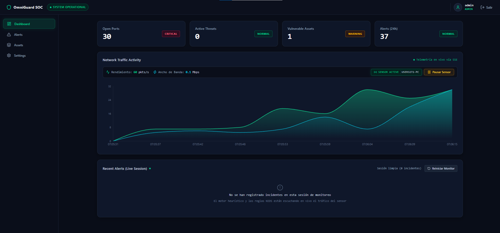

# OmniGuard SOC — Núcleo Transaccional y API REST Empresarial

<div align="center">
  
  <h3>Plataforma Distribuida de Ciberseguridad Defensiva y Alerta Temprana</h3>
  <p>Backend Empresarial bajo Arquitectura Hexagonal, Seguridad Zero-Trust con PASETO v4 y Transmisión en Tiempo Real</p>
</div>

---

## 1. Resumen Ejecutivo y Propósito

El microservicio `omniguard-core-java` constituye el núcleo transaccional, de autenticación y de gobierno de datos del sistema OmniGuard SOC. Desarrollado sobre la plataforma Java 21 y el framework Spring Boot 3.2, implementa rigurosamente el patrón de **Arquitectura Hexagonal (Puertos y Adaptadores)** para aislar la lógica de dominio de las dependencias externas, proveedores de base de datos y protocolos de transporte.

Entre sus responsabilidades críticas se encuentran la administración de identidades y accesos (IAM), la emisión y verificación criptográfica de tokens PASETO v4 transportados en cookies seguras, el control de acceso basado en roles (RBAC), la limitación de tasa de peticiones mediante algoritmos de Token Bucket respaldados en memoria distribuida, la ingesta segura de incidentes emitidos por los analizadores y la transmisión en vivo de eventos hacia la consola de mando mediante Server-Sent Events (SSE).

---

## 2. Vista Previa del Sistema

<div align="center">
  
  <p><em>Consola de mando y autenticación protegida del ecosistema OmniGuard SOC.</em></p>
</div>

---

## 3. Arquitectura Hexagonal (Puertos y Adaptadores)

La estructura del código fuente prescinde del modelo clásico MVC acoplado, garantizando que el núcleo de negocio no dependa de ningún componente de infraestructura o marco de trabajo externo:

```
+-------------------------------------------------------------------------------+
|                             ADAPTADORES DE ENTRADA                            |
|  - RestControllers (/auth, /alerts, /assets, /dashboard, /notifications)      |
|  - InternalWebhookController (/internal/alerts con token precompartido)       |
+---------------------------------------+---------------------------------------+
                                        |
                                        v (Usa Puertos de Entrada)
+-------------------------------------------------------------------------------+
|                              CAPA DE APLICACIÓN                               |
|  - Servicios de Dominio (AuthService, AlertService, AssetService)             |
|  - Casos de Uso y Validaciones de Reglas de Negocio                           |
+-------------------------------------------------------------------------------+
                                        |
                                        v (Reglas Invariantes)
+-------------------------------------------------------------------------------+
|                                CAPA DE DOMINIO                                |
|  - Modelos de Entidad Puros (User, Role, Alert, Asset, Vulnerability, Policy) |
|  - Objetos de Valor (Email, PasswordHash, SeverityLevel, TokenPayload)        |
|  - Excepciones de Dominio (InvalidCredentialsException, AssetNotFoundException)|
+-------------------------------------------------------------------------------+
                                        ^
                                        | (Implementa Puertos de Salida)
+---------------------------------------+---------------------------------------+
|                             ADAPTADORES DE SALIDA                             |
|  - Repositorios Spring Data JPA / Hibernate (PostgreSQL 16)                   |
|  - Adaptador de Criptografía (PasetoLocalTokenService, Argon2PasswordEncoder) |
|  - Adaptador de Caché y Rate Limiting (Redis Lettuce, Bucket4j)               |
|  - Adaptador de Transmisión en Tiempo Real (SseEmitterAlertPublisher)         |
+-------------------------------------------------------------------------------+
```

---

## 4. Estrategia de Seguridad Defensiva y Autenticación

El microservicio implementa estándares avanzados de seguridad informática y control de acceso:

### 4.1. Sustitución de JWT por Tokens PASETO v4
En concordancia con las mejores prácticas contemporáneas para mitigar vulnerabilidades inherentes a JWT (tales como la manipulación de algoritmos en el encabezado `alg: none` o confusión de claves simétricas/asimétricas), el sistema adopta **PASETO v4 en su modalidad local (`v4.local`)**:
* **Cifrado Autenticado Simétrico (AEAD):** Utiliza algoritmos criptográficos modernos de grado militar (ChaCha20-Poly1305 / Ed25519) con una clave maestra de 256 bits (`PASETO_SECRET_KEY`).
* **Inviolabilidad de Carga Útil:** La totalidad del payload viaja cifrada y autenticada; ningún intermediario puede inspeccionar o forjar los atributos de identidad sin invalidar el tag de autenticación.

### 4.2. Aislamiento Estricto de Sesión en Cookies HttpOnly
Para erradicar el riesgo de secuestro de sesión mediante vulnerabilidades de Cross-Site Scripting (XSS), los tokens jamás se entregan en el cuerpo de las respuestas JSON ni se almacenan en el `localStorage` o `sessionStorage` del cliente web:
* **Cookie de Acceso (`at`):** Contiene el token de corta vigencia (15 minutos) con directivas `HttpOnly`, `SameSite=Strict` y `Secure`.
* **Cookie de Refresco (`rt`):** Contiene el token de rotación periódica (30 días), permitiendo la renovación silenciosa de sesiones activas desde el endpoint `/api/v1/auth/refresh`.

### 4.3. Hashing de Contraseñas con Argon2id
El almacenamiento de credenciales en el esquema `iam` se realiza exclusivamente mediante el algoritmo de derivación de claves **Argon2id** (integrado mediante la biblioteca criptográfica BouncyCastle):
* Parámetros de resistencia física ajustados para neutralizar ataques basados en paralelismo masivo por GPU y circuitos ASIC específicos.

### 4.4. Control de Acceso Basado en Roles (RBAC)
Los privilegios del sistema se segregan jerárquicamente a nivel de controlador y método mediante anotaciones `@PreAuthorize`:
* `ROLE_ADMIN`: Control total de configuración de canales, disparo de auditorías de red y administración de operadores.
* `ROLE_ANALYST`: Visualización de telemetría forense, actualización del estado de incidentes y consulta de inventario.
* `ROLE_VIEWER`: Consulta básica de métricas agregadas del SOC en modo de solo lectura.

### 4.5. Mitigación de Denegación de Servicio (Rate Limiting)
Protección distribuida implementada mediante **Bucket4j** respaldado por Redis para rutas de alta sensibilidad (por ejemplo, `/api/v1/auth/login`), restringiendo intentos indebidos de fuerza bruta a un máximo de 5 peticiones por minuto por dirección IP.

---

## 5. Transmisión en Tiempo Real con Server-Sent Events (SSE)

Para proveer al analista de una vista reactiva sin introducir la sobrecarga de handshake bidireccional de WebSocket, el backend expone el canal unidereccional `/api/v1/alerts/stream`:
1. El cliente web establece una conexión HTTP persistente (`text/event-stream`).
2. Cada vez que el controlador interno recibe una alerta desde `omniguard-analyzer-python`, un publicador de eventos en memoria despacha el incidente estructurado de forma asíncrona a todos los emisores activos registrados.
3. Se implementan mecanismos automáticos de desconexión por timeout (30 minutos) y limpieza de suscriptores huérfanos para salvaguardar el pool de hilos del servidor de aplicaciones.

---

## 6. Especificación de la API REST

A continuación se resumen los contratos principales expuestos por el microservicio:

| Método | Endpoint | Descripción | Acceso / Requisitos |
| :--- | :--- | :--- | :--- |
| `POST` | `/api/v1/auth/login` | Autentica al analista y emite las cookies `at` y `rt`. | Público (Rate limit: 5 req/min). |
| `POST` | `/api/v1/auth/refresh` | Renueva el token de acceso rotando la sesión activa. | Requiere cookie `rt`. |
| `POST` | `/api/v1/auth/logout` | Invalida la sesión activa y elimina las cookies del cliente. | Requiere autenticación. |
| `GET`  | `/api/v1/auth/me` | Retorna los metadatos y privilegios del analista en sesión. | Requiere autenticación. |
| `GET`  | `/api/v1/dashboard/stats` | Provee los 4 KPIs del SOC, telemetría y distribución de riesgo. | Requiere autenticación. |
| `GET`  | `/api/v1/alerts` | Lista paginada y filtrable de alertas por severidad y estado. | Requiere autenticación. |
| `GET`  | `/api/v1/alerts/{id}` | Detalle forense completo y payload crudo del incidente. | Requiere autenticación. |
| `PATCH`| `/api/v1/alerts/{id}/status` | Transiciona el estado del incidente (`INVESTIGANDO`, `RESUELTA`). | Requiere rol `ROLE_ANALYST`. |
| `GET`  | `/api/v1/alerts/stream` | Transmisión continua de eventos críticos vía Server-Sent Events. | Requiere autenticación. |
| `GET`  | `/api/v1/assets` | Inventario consolidado de activos de red descubiertos. | Requiere autenticación. |
| `GET`  | `/api/v1/assets/{id}` | Ficha de activo, puertos detectados y vulnerabilidades CVE. | Requiere autenticación. |
| `POST` | `/api/v1/assets/{id}/scan` | Emite orden de auditoría activa publicando en Redis. | Requiere rol `ROLE_ADMIN`. |
| `GET`  | `/api/v1/notifications/settings` | Consulta webhooks configurados y canales de notificación. | Requiere rol `ROLE_ADMIN`. |
| `PUT`  | `/api/v1/notifications/settings` | Actualiza URLs de webhook y credenciales de alerta externa. | Requiere rol `ROLE_ADMIN`. |
| `POST` | `/api/v1/internal/alerts` | Ingesta de incidentes originados por el analizador Python. | Requiere token `X-Internal-Token`. |

*Nota: La documentación interactiva OpenAPI / Swagger UI se encuentra disponible en `/swagger-ui.html` durante la ejecución en entornos de desarrollo.*

---

## 7. Esquemas de Base de Datos y Migraciones Flyway

La persistencia se ejecuta sobre PostgreSQL 16 estructurado bajo particionamiento lógico de esquemas:
* **`iam`:** Tablas `users`, `roles`, `user_roles` y `refresh_tokens`.
* **`assets`:** Tablas `network_assets`, `discovered_ports` y `cpe_matches`.
* **`alerts`:** Tablas `security_alerts`, `alert_forensics` y `notification_logs`.

Todas las modificaciones a la estructura de la base de datos se versionan mediante **Flyway** en el directorio `src/main/resources/db/migration`, garantizando despliegues repetibles y consistencia de esquemas entre ambientes.

---

## 8. Variables de Entorno y Configuración

El archivo `application.yml` parametriza el entorno a través de las siguientes variables:

| Variable | Tipo | Descripción |
| :--- | :--- | :--- |
| `SPRING_DATASOURCE_URL` | String | URL JDBC de conexión a PostgreSQL (`jdbc:postgresql://localhost:5432/omniguard_db`). |
| `SPRING_DATASOURCE_USERNAME` | String | Usuario de base de datos con permisos sobre esquemas. |
| `SPRING_DATASOURCE_PASSWORD` | String | Contraseña de base de datos. |
| `SPRING_DATA_REDIS_HOST` | String | Host del servidor Redis para caché y rate limiting. |
| `SPRING_DATA_REDIS_PORT` | Entero | Puerto de escucha de Redis (6379). |
| `OMNIGUARD_SECURITY_PASETO_SECRET` | String | Clave simétrica de 256 bits codificada en Base64 para cifrado de tokens. |
| `OMNIGUARD_SECURITY_INTERNAL_TOKEN` | String | Token secreto precompartido para el endpoint `/api/v1/internal/alerts`. |
| `CORS_ALLOWED_ORIGINS` | String | Orígenes permitidos para peticiones de explorador (ej. `http://localhost:5173`). |

---

## 9. Compilación, Análisis Estático y Pruebas

El proyecto se gestiona mediante Gradle Kotlin DSL (`build.gradle.kts`) e incluye plugins integrados de aseguramiento de calidad:

### 9.1. Compilación del Código Fuente
```powershell
./gradlew clean compileJava
```

### 9.2. Ejecución de Pruebas Unitarias e Integración
```powershell
./gradlew test
```

### 9.3. Verificación de Estilo y Detección de Vulnerabilidades
```powershell
# Verificación de formato y estándares de estilo
./gradlew spotlessCheck checkstyleMain

# Análisis estático de bugs potenciales
./gradlew spotbugsMain

# Auditoría OWASP de dependencias de terceros
./gradlew dependencyCheckAnalyze
```

---

## 10. Despliegue en Contenedores

La imagen de producción puede generarse directamente mediante Jib sin requerir un daemon de Docker local, o mediante el Dockerfile provisto:

```powershell
# Compilación mediante Docker
docker build -t omniguard-core-java:1.0 .

# Ejecución del contenedor
docker run -d \
  --name omniguard-core \
  --network omniguard-net \
  -p 8080:8080 \
  --env-file .env \
  omniguard-core-java:1.0
```
